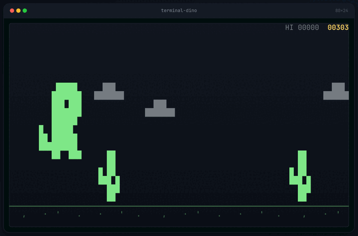
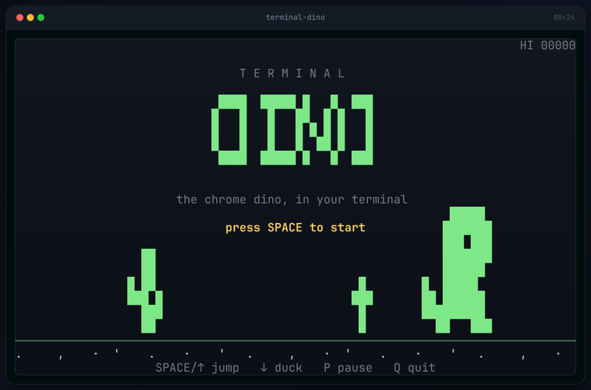
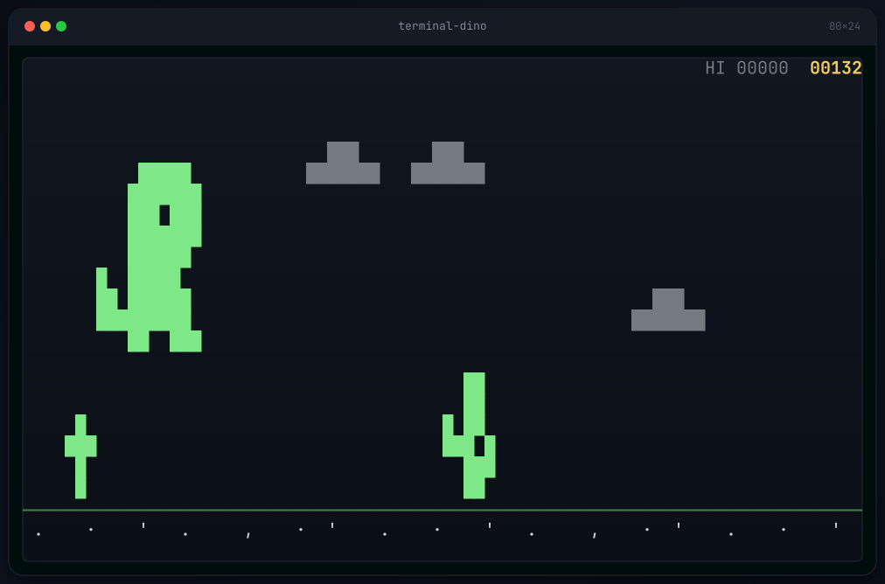
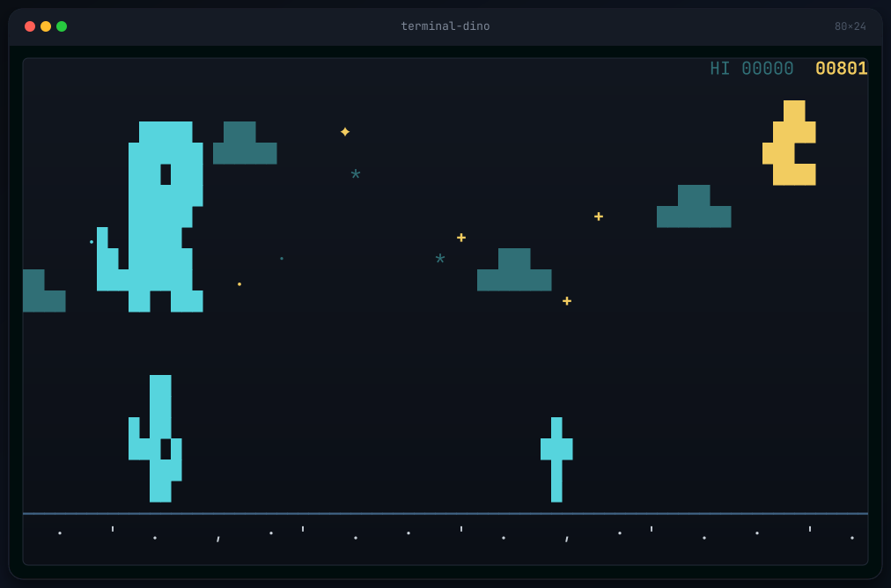
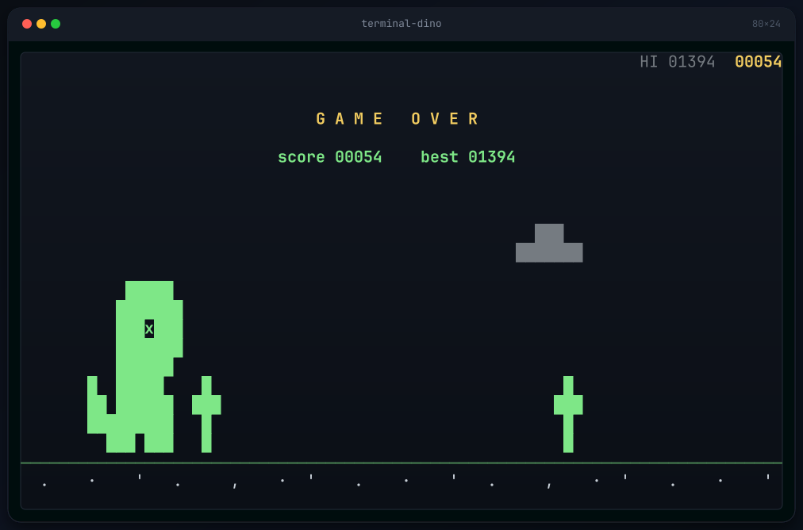
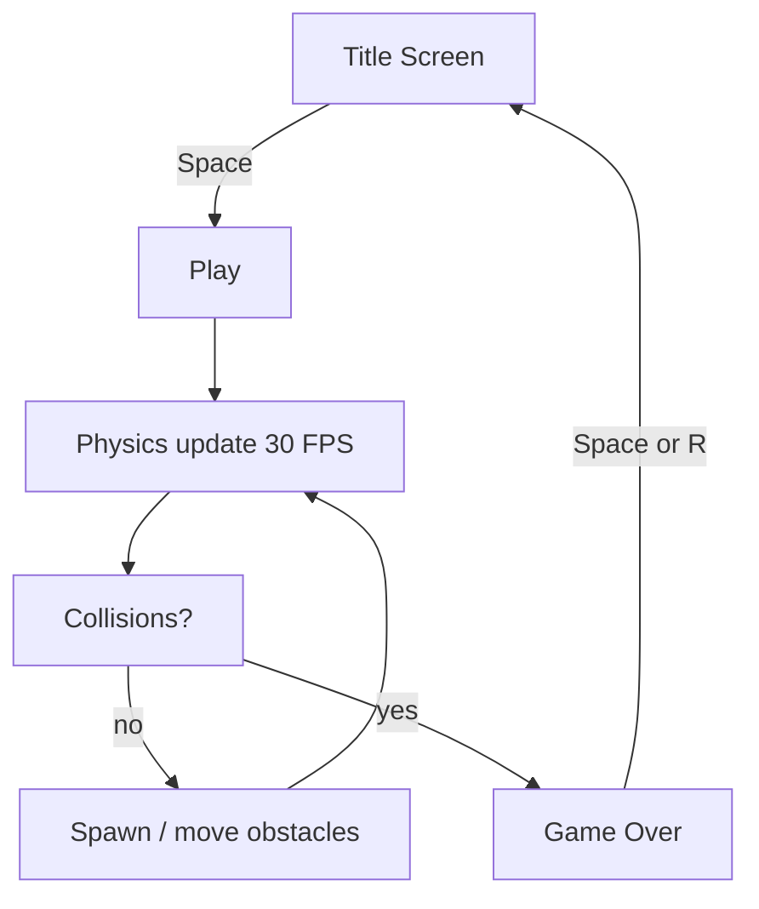

# terminal-dino 🦖

A small, dependency-free **Chrome Dino game for your terminal**.
No browser, no network — just Python 3 and the standard library.



<p align="center">
  
  
  
</p>


## Highlights

- 🏃 Block-art dino with run / jump / duck, 30 FPS and dt-based physics
- 🌵 Small & large cacti plus birds, growing spawn gaps as speed rises
- 📈 Score, speed cap (30 → 65) and day/night cycles (flip every 500 points)
- 🌙 Night mode: twinkling stars + moon; clouds parallax over the ground
- ☁️ Adapts to any terminal size — minimum 40×18, tested up to 120×40
- 💾 Persistent high-score at `~/.local/share/terminal-dino/highscore`
- 📦 Zero dependencies — stdlib `curses` only


## Installation

### Linux / macOS (one line)

```bash
curl -fsSL https://raw.githubusercontent.com/Abdulhadi446/terminal-dino/main/install.sh | bash
```

Or clone and install locally:

```bash
git clone https://github.com/Abdulhadi446/terminal-dino.git
cd terminal-dino
./install.sh            # installs into ~/.local/bin
```

System-wide (only if `/usr/local/bin` exists and you can write it):

```bash
sudo ./install.sh --system
```

Custom prefix:

```bash
./install.sh --prefix "$HOME/.bin"
```

The installer also drops a desktop entry in `applications/`, so the game shows up
in menus (Launch terminal + run `dino`).

### Windows (PowerShell, one line)

```powershell
irm https://raw.githubusercontent.com/Abdulhadi446/terminal-dino/main/install.ps1 | iex
```

Or clone and install locally:

```powershell
git clone https://github.com/Abdulhadi446/terminal-dino.git
cd terminal-dino
Set-ExecutionPolicy -Scope CurrentUser -ExecutionPolicy RemoteSigned -Force
.\install.ps1
```

- Windows Python does not ship `curses`: either use
  `pip install windows-curses`, or (recommended) install and run inside WSL.
- A Start Menu shortcut is created under *Terminal Dino*.

### Manual (all platforms)

```bash
# Windows / no ./install.sh
python3 dino.py
# Windows
python dino.py         # add `pip install windows-curses` if import curses fails
```

---

## Try it

```bash
git clone https://github.com/Abdulhadi446/terminal-dino.git
cd terminal-dino
chmod +x dino.py
./dino.py
```

## Controls

| keys | action                |
|------|-----------------------|
| `Space` / `↑` / `W`  | jump                  |
| `↓` / `S`            | duck (timed, 1.2 s)  |
| `P`                  | pause / resume        |
| `R`                  | restart after game over |
| `Q` / `Esc`          | quit                  |

## Options

| flag            | effect                           |
|-----------------|----------------------------------|
| `--demo`        | watch the autopilot play         |
| `--reset-best`  | clear the saved high score       |

## Screenshots

| Title | Day | Night |
|---|---|---|
|  |  |  |



## How it works



## Project structure

```
terminal-dino/
├── dino.py            # game (no deps)
├── README.md
└── assets/            # screenshots + demo.gif
```

## Tuning constants

Open `dino.py` and edit the constants near the top — jump height, gravity,
gravity was tuned to still clear three-tile cactus clusters:

```python
JUMP_V = 42.0
GRAVITY = 88.0      # jump peak ≈ 10 rows, airtime ≈ 0.95 s
BASE_SPEED = 30.0
MAX_SPEED = 65.0
SCORE_PER_CELL = 0.45
NIGHT_EVERY = 500
```

## Game details

- **Hitboxes** are computed from the block-art — cacti use column runs, so
  clustered spikes become a single solid box.
- **Jump** is timed at 1.2 s duck (terminals have no reliable key-up event).
- **High score** is stored in your XDG data dir.
- **`--demo`** never writes the high score; normal play will.

## Compatibility

- Python 3.8+ built with `curses`
- Tested on `xterm-256color`, `tmux`, and common Omarchy terminals
- On Windows, the standard `curses` isn't available; use WSL

## Credits

The block sprites, palette and pacing borrow from Google's offline Chrome
dinosaur, built here in pure terminal text.

## License

MIT
EOF
echo "written"